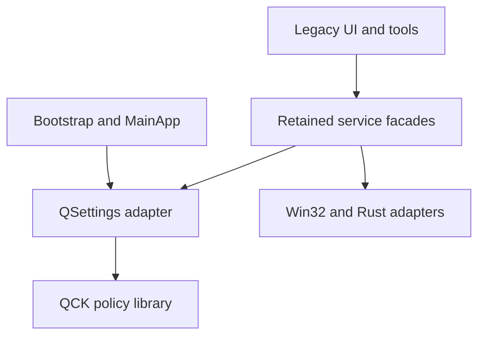

# Architecture and migration

## Current execution and ownership

`cpp/src/main.cpp` dispatches the MP4 worker before Qt, otherwise calls
`core/bootstrap.cpp`. Bootstrap resolves settings and the QCK feature snapshot,
handles optional admin startup and creates `MainApp`. `MainApp` owns the app,
hotkeys, tray, capture controller and preloader. Legacy singleton managers still
own OCR, translation, pins and history.

Capture flows from `CaptureService` (GDI or DXGI/HDR) into `ScreenshotWindow`,
canvas/selection/annotation, then `core/clipboard_utils.cpp` for direct copy/save.
History instead uses `clipboard/core/manager.cpp` and the Rust SQLite backend.
Disabling history does not disable direct copy or pinning the system clipboard image.

OCR uses `OCRManager` and copied Snipping Tool DLLs or PP-OCR/ONNX. Both dynamic
backends refuse elevated/high-integrity hosts at their native load boundary,
independently of settings. The PP-OCR Rust loader/open path enforces this too. Translation
uses `TranslationManager`, workers/providers and WinHTTP. Image translation needs
OCR and translation; text translation does not require OCR or history. Recording
uses GIF/native Rust components or a separate MP4 worker. Updates/models use
a separate Rust HTTPS transport.

## First extracted boundary

`cpp/policy` is the C++20 target `qck_feature_policy`. It has no Qt, Rust,
filesystem, network or platform dependencies. It owns typed stable IDs, defaults,
build availability, switch parsing and dependency queries.
`core/feature_settings.cpp` adapts QSettings to an immutable startup snapshot.
The retained app depends on policy; policy never depends on the app.
`QCK_POLICY_ONLY` returns before Qt discovery, FetchContent or Cargo.

The retained `jietuba_lib` is still a broad aggregate. Optional code and shared
dependencies still compile/link. These flags are not dependency elimination.
Some legacy UI controls remain visible while their service refuses execution;
tray actions and the admin-startup card reflect availability.

## Migration sequence

| Stage | Boundary | Required evidence |
|---|---|---|
| 1, this change | Qt-free policy, settings adapter, representative service gates | Policy matrix and explicit application qualification gaps |
| 2 | Owned service start/stop/readiness and complete UI wiring | Qt integration tests: no sensitive calls/workers when disabled; restart/import tests |
| 3 | Extract capture, direct clipboard delivery and platform targets | Capture/copy tests independent of OCR/translation/history |
| 4 | Separate optional CMake targets and Cargo features | Build/link matrices prove missing dependencies; measure size/private bytes/latency |
| 5 | Flag scrolling, annotation, pinning, GIF/MP4 and barcode | Enabled/disabled integration and desktop tests |
| 6 | Qualify native caches, instance IPC, task setup and fork release provenance | Security regressions and isolated release builds |

Use interfaces at actual ownership/platform boundaries. Do not add a DI container,
event bus or remote flag service. Keep upstream source paths, C ABI and crate names
so upstream fixes stay reviewable.

Admin startup and updater execution are default-disabled, not removed. Fixed
security checks are separate: instance replacement validates full image/account
and creation time on the handle it terminates; task setup uses a fixed elevated
self helper and an in-memory Task Scheduler definition. No caller-supplied XML,
path, account or task name crosses that helper boundary. Manual elevation cannot
bypass the native OCR guard. Supporting OCR alongside administrative capture
would require a separate non-elevated worker.
